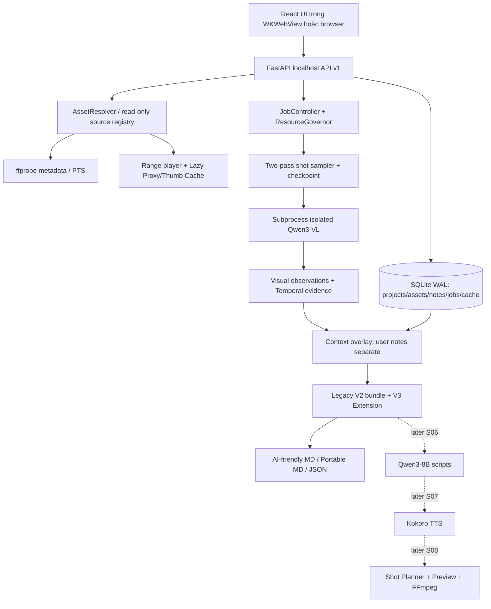

# PhuThanhAI V3.0 — 00_MASTER_ARCH

> **Đặc tả sản phẩm:** 3.0.0 • **Ngày:** 2026-11-11 • **Môi trường đích:** MacBookPro18,3 / M1 Pro / 16 GiB RAM / macOS • **Trạng thái:** THIẾT KẾ, CHƯA PHẢI ỨNG DỤNG ĐÃ CODE/ĐÃ BENCHMARK.
>
> **Mục đích:** Hướng dẫn AI Coder tạo ứng dụng local-first để xem, ghi chú, phân tích **mọi thể loại video**, rồi tùy chọn tạo POV tự động. Tập trung vào tốc độ duyệt clip, độ trung thực của báo cáo, khả năng phục hồi và giới hạn RAM 16 GiB.

## 0. Chỉ thị bắt buộc dành cho AI Coder

1. Đọc **00 → 03 → 01**, sau đó chỉ dùng **02** làm hợp đồng tương lai. Đọc `README_FIRST.md`, `IMPLEMENTATION_CHECKLIST.md` và schema/fixtures đi kèm.
2. Tạo dự án tại `/Users/phuthanh/APP_CaNhan/PhuThanhAI`; tạo môi trường **riêng** bằng `uv` (hoặc venv mới), **không cài vào** AIVideo `.venv`, không tải lại/ghi sửa model cũ.
3. Giữ nguyên 4 tab cấp cao: **Thư viện & Video Analyzer / AI Video POV / Phần 3 / Phần 4**. Tab POV có 3 sub-tab **Dữ kiện / Kịch bản / Sản phẩm**. Hai tab sau là placeholder đúng nghĩa.
4. Tuần tự **S00 → S05** (hoàn thiện Video Analyzer), rồi mới **S06 → S08** (POV). Chỉ chuyển tiếp khi gate PASS có **lệnh chạy, kết quả test thật, tài nguyên đo trên Mac đích**. Mock không thể thay cho integration test.
5. V3 không được phá việc import báo cáo V2: giữ `AnalysisReport/1.0.0` và `ProjectBundle/1.0.0` cũ, thêm extension độc lập `WorkspaceExtension/1.0.0`; đóng gói portable `WorkspacePackage/1.0.0`. **Product 3.0.0 không có nghĩa contract 3.0.0.**
6. Không gán các sự kiện do người dùng ghi chú là AI đã quan sát; không đánh đồng 05:00 theo đồng hồ với 00:05:00 của clip; không gọi lấy mẫu từng vài giây là đã xem mọi frame.
7. Nếu runtime thực tế thiếu hỗ trợ video/multi-image, chọn đường **single-frame** đã kiểm chứng; không ép nâng cấp package, không tải tự động, không báo tính năng PASS khi chưa chạy.
8. Không hứa đạt **100/100** khi chưa qua rubric và bằng chứng kiểm thử; những điểm số trong tài liệu là **đích nghiệm thu**, không phải kết quả hiện có.

## 1. Tầm nhìn và các luồng người dùng

**Phần 1 — Universal Media Library & Video Analyzer (làm ngay):** nhập từng file hoặc cả thư mục (hàng trăm/nghìn clip); thư viện dạng lưới/danh sách; xem nhanh ngay trong app; tua theo timecode; ghi chú tự do tại dự án, clip hoặc đoạn; gắn sao/nhãn/tags; phân tích có/không có ghi chú; mô tả video theo thời gian, có nguồn bằng chứng; xuất `.md` cho ChatGPT hoặc `.md` portable/JSON cho máy.

**Phần 2 — AI Video POV (sau khi Phần 1 ổn):** nhận nhiều clip đã phân tích + ghi chú thực tế; Qwen3-8B đề xuất 3 kịch bản khác về cấu trúc kể chuyện; chọn/sửa; Kokoro tiếng Việt; chọn cảnh nguồn đúng timecode; dựng preview, chỉnh sửa shot mà không chạy lại toàn bộ AI; xuất MP4/SRT/WAV/manifest.

**Phần 3 & 4:** để trống, không phát triển ngầm. Analyzer tuyệt đối không bị buộc vào POV/wedding; wedding là **một preset ngôn ngữ/xuất báo cáo**, không phải giả định nhận diện.

### Trải nghiệm bắt buộc: ghi chú cạnh video

Khi mở `Clip_023.mov`, người dùng thấy video player và ô `Ghi chú cho clip`, có thể nhập **"Lên phà lúc 5 giờ sáng, đợi khoảng 30 phút"**. Bấm `Gắn tại vị trí hiện tại` để lưu note time-range; để mặc định là note toàn clip. Auto-save có chỉ báo, lặp tắt/mở app không mất. Nếu không ghi chú, analyzer vẫn hoạt động. Nội dung được hiển thị trong báo cáo dưới nhãn **Dữ kiện người dùng**, không tráo thành **AI trực tiếp nhìn thấy**. Nếu cảnh mâu thuẫn ghi chú, UI cho review.

## 2. Quyết định công nghệ V3 — Tối ưu theo UX, không phình backend

| Tầng | Quyết định V3 | Tại sao / giới hạn |
|---|---|---|
| Media & AI core | **Python 3.12**, package `phuthanhai` độc lập | Dùng FFmpeg/MLX/torch có sẵn, dễ test headless |
| Local API | **FastAPI + Uvicorn** bind 127.0.0.1 | Chia UI khỏi model; API hợp đồng versioned; 1 backend owner |
| UI desktop | **React + TypeScript/Vite build tĩnh**, ảo hóa danh sách + lazy thumbnails | Khi có hàng trăm clip, ghi chú inline & timeline cần kiểm soát state/virtualization hơn Gradio |
| macOS app | **SwiftUI launcher mỏng + WKWebView**; mở browser local khi WebView có lỗi đã biết | Spotlight/Dock/icon, không chứa AI logic trong Swift; không tái tạo IPC 42 methods |
| UI giai đoạn S00 | Shell với các tab + media library scaffold; **không chạy đồng thời Gradio** | Tránh hai giao diện/engine cạnh tranh tài nguyên |
| Model runner | **MLX-VLM Qwen3-VL-4B 4bit**, **MLX-LM Qwen3-8B 4bit** | Đường dẫn local, runtime phải được G0 chứng minh |
| Voice | Kokoro-Vietnamese CPU | Chỉ giai đoạn S07; giọng nam miền Nam **phải nghe duyệt** |
| Media | FFmpeg/ffprobe 7.1.1, OpenCV/Pillow khi cần | Frame decode/scene candidates, proxy H.264 khi không phát được |
| Playback | HTML5/WKWebView video với HTTP Range từ API; **proxy on demand**; optional native AVPlayer spike nếu khả thi | Chỉ một player active, không encode tất cả file trước |
| Storage | SQLite WAL **6–8 bảng vận hành** + JSON canonical portable | Không 23 bảng; transaction cho note, jobs, cache và refs |
| Lock & worker | Single heavy-model slot + subprocess isolated + watchdog | Exit/reap trước model kế; 1 owner API/CLI scheduler |
| Package manager | `uv` + lockfile; Node lockfile build UI | Build có thể dùng mạng **nếu được phép**, nhưng app hoạt động offline hoàn toàn sau khi cài |

**Quyết định thay thế Gradio:** V2 chọn Gradio để ra MVP nhanh; V3 ưu tiên duyệt nhiều clip, tùy chỉnh note theo dòng và premium UI, nên **chuyển sang FastAPI + React** trước khi viết sâu UI. Không vội viết thêm native video editor. Nếu G0 spike chứng minh React/WKWebView trên máy đích không đáp ứng file picker/proxy/seek, phương án dự phòng là trình duyệt ngoài với cùng React app; không âm thầm fallback sang Gradio và viết hai UI.

**Không bắt buộc cài thêm model:** Mọi gợi ý như whisper.cpp chỉ là opt-in sau G5 khi người dùng cần hiểu âm thanh, không thuộc tiêu chí PASS của Video Analyzer V3 thị giác.

## 3. Tài nguyên tái sử dụng (phải kiểm thực tế bằng `doctor`)

| Mục đích | Nguồn đã có |
|---|---|
| Repo tham khảo | `/Users/phuthanh/APP_CaNhan/AIVideo/workers/src/aivideo_workers/` |
| Python tham chiếu | `/Users/phuthanh/APP_CaNhan/AIVideo/workers/.venv/bin/python` |
| Python MLX thay thế | `/Users/phuthanh/Library/Application Support/AIVideo/Runtimes/g0-mlx-runtime/bin/python` |
| Qwen3-VL | `/Users/phuthanh/Library/Application Support/AIVideo/Models/visual_analysis_primary` |
| Qwen3-8B | `/Users/phuthanh/Library/Application Support/AIVideo/Models/story_synthesis` |
| Qwen3-0.6B optional | `/Users/phuthanh/Library/Application Support/AIVideo/Models/g0-text/73e3e38d981303bc594367cd910ea6eb48349da8` |
| Kokoro-Vietnamese | `/Users/phuthanh/Library/Application Support/AIVideo/Models/tts_kokoro_vi` |
| FFmpeg/ffprobe | `/opt/homebrew/bin/ffmpeg` và `/opt/homebrew/bin/ffprobe` |
| Legacy modules | `local_model.py`, `story_writer.py`, `tts_engine.py`, `native_render.py` (chỉ dùng lại sau audit API/deps/license) |

Mọi `file://` trong brief là link hiển thị, **không phải đường dẫn filesystem**. G0 xác nhận Python ABI, Metal, tokenizer/processor, snapshot manifest, voicepacks, ffmpeg encoders, môi trường offline trước khi quyết định runtime. Không dựa vào thông số kích thước download làm ước lượng RAM peak.

## 4. Kiến trúc logic & luồng dữ liệu



**Lưu ý:** `RAW` là sự thật thị giác được ghi riêng; FUSION không sửa quan sát gốc, chỉ tạo overlay rõ nguồn. Các mốc `start_ms/end_ms` luôn nằm trong timeline **của chính asset**, còn `time_of_day` là giờ thực tế người dùng cung cấp (có thể chưa biết ngày/múi giờ).

### Runtime flow

```text
Open .app → check single-instance + spawn FastAPI child
→ health check → render React bundle nội bộ → indexed library (không nạp AI)
→ click video → HTTP Range player, fallback proxy on demand
→ add note/autosave → local SQLite WAL
→ analyze selected → FFprobe + sampling + checkpoint
→ acquire heavy-slot → VLM subprocess (one model) → observations
→ release slot and reap → overlay note → validate → reports
→ optional transfer to POV (chưa chạy cho đến G5 PASS)
```

## 5. Sơ đồ thư mục triển khai (không rườm rà)

```text
/Users/phuthanh/APP_CaNhan/PhuThanhAI/
├── docs/                          # 4 tài liệu hợp đồng
├── contracts/                     # json schema V2 legacy + V3 extension
├── tests/                          # unit/integration/golden + smoke marker
├── src/phuthanhai/
│   ├── __init__.py
│   ├── cli.py                      # doctor, serve, import, analyze, validate
│   ├── config.py                   # local paths, budgets, no secrets hardcoded
│   ├── api/{app,routes,security}.py
│   ├── library/{index,preview,notes,store}.py
│   ├── analyzer/{probe,sampler,worker,report}.py
│   ├── runtime/{scheduler,resource,checkpoint}.py
│   ├── contracts/{models,validators,migrate}.py
│   ├── pov/                        # skeleton đến S06
│   └── utils/{fs,hashes,logging}.py
├── web/                            # React + TS, Vite, virtual list
├── macos/PhuThanhAI/              # SwiftUI launcher / icon / bundle
├── tools/                          # dev scripts + smoke
├── pyproject.toml, uv.lock
└── README.md

~/Library/Application Support/PhuThanhAI/  # dữ liệu vận hành, KHÔNG đặt trong source repo
├── registry.sqlite3
├── projects/<project-id>/
│   ├── analysis/<asset-id>/{analysis.json,video_report_ai.md,video_report_portable.md}
│   ├── project_{bundle,workspace}.json
│   ├── reports/{project_report_ai.md,project_report_portable.md}
│   └── jobs/<job-id>/{checkpoint.json,events.jsonl,logs/}
└── caches/{thumbs,preview_proxies,sampling}/  # xóa được, giới hạn dung lượng
```

**Nguyên tắc ownership:** chỉ đọc footage tại đường dẫn gốc; mọi ghi ra `Application Support/PhuThanhAI`, không dùng đường dẫn nguồn làm output; xóa cache không xóa note/manifest/analysis. Chỉ launcher nắm backend process; đóng app thì dừng các worker do nó sở hữu, flush note, kiểm tra có job đang chạy để hỏi xác nhận hủy.

## 6. SQLite tối giản, registry & cache

**Bảng dự kiến (7):** `projects`, `assets`, `annotations`, `review_overlays`, `jobs`, `cache_entries`, `settings`. `analyses` có thể lưu JSON canonical theo file và path trong `assets`; không cần bảng thứ tám nếu chưa có truy vấn thực sự. Các bảng có index theo `project_id`, `asset_id`, `status`, `created_at` và migration `PRAGMA user_version`.

- `assets`: local absolute path nội bộ, `st_dev/st_ino` nếu có, size, mtime_ns, codec/duration, `sha256 nullable`, source status. **Fast fingerprint chỉ là tín hiệu thay đổi**, không thay SHA-256 cho report/POV render.
- Thêm asset: lập tức ghi metadata/row; tạo thumbnail theo queue có giới hạn; full SHA-256 tính khi bắt đầu phân tích hoặc xuất portable có yêu cầu hash. Trước dựng kiểm lại hash; nếu nguồn đã thay thì invalidation/relink.
- Exact duplicates (SHA-256 trùng) được gợi ý nhóm, không tự xóa; near duplicates từ pHash/embedding chỉ là candidate, không tự gộp thành một source. Không duplicate 4K proxy nếu có proxy hợp lệ.
- Cache key bao gồm `source_sha256`, segment PTS, profile, extractor/model/prompt/processor version và config ảnh. Nếu chỉ sửa note, **không chạy lại inference VLM**; chỉ refresh overlay/báo cáo.
- `cache_entries`: size, atime, pinned, validity, source version. LRU với ngân sách cấu hình; proxy tạo **khi preview cần**, không generate toàn thư viện; không dọn cache của job đang chạy.
- SQL WAL + busy_timeout; một DB write queue/transaction, autosave note debounce và flush khi đổi clip/đóng app. Revision optimistic concurrency để không ghi đè note cũ từ callback trễ.

## 7. ResourceGovernor & isolated workers (quy tắc cứng 16 GB)

- **Một `AI_HEAVY` slot duy nhất** cho VLM, LLM, TTS. FFmpeg full render dùng `MEDIA_HEAVY` và không chạy song song VLM/LLM ở MVP. Thumbnails/ffprobe dùng `MEDIA_LIGHT` queue giới hạn; UI playback ưu tiên hơn thumbnail jobs.
- Controller đóng vai trò allocator (không cần thêm AI model). Monitor macOS memory pressure/swap + RSS/PID, kiểm tra dung lượng đĩa và nhiệt/power **nếu API cho phép**. Trạng thái `normal / pressured / critical` dựa benchmark, không đặt ngưỡng tuyệt đối giả.
- Spawn bằng `subprocess.Popen([sys.executable, "-m", ...])`, không shell interpolation; worker stdout chỉ JSONL; stderr là diagnostic có giới hạn; IPC messages có size cap, schema, job ID. Worker nạp model một lần theo job và xử lý tuần tự, không load trong FastAPI/UI process.
- Exit: cooperative cancel → SIGTERM process group → timeout → SIGKILL → `wait()`/reap; chỉ nhường slot khi worker chết và state đã ghi. Dừng app/restart không orphan child; scheduler có lock ở **server process**, không chỉ UI click (CLI cùng server qua API, không spawn controller thứ hai).
- OOM: lưu checkpoint trước retry; hạ size ảnh/budget token hoặc single-frame, tối đa 2 retry theo cùng job; nếu vẫn lỗi thì `partial/failed` rõ nguyên nhân, tuyệt đối không báo hoàn thành.
- Battery mode: option `Eco` giảm thumbnail/decode concurrency và độ phân giải; không tự đổi chất lượng phân tích mà không ghi provenance.
- Performance telemetry **cục bộ**: per-stage elapsed, peak RSS, memory pressure transitions, GPU/model cache nếu đo được; không gửi network.

## 8. API/local security & Spotlight

V3 API tối thiểu: `GET /api/v1/health`, `GET /api/v1/projects`, `POST /api/v1/projects`, `POST /api/v1/projects/{id}/assets:scan`, `GET /api/v1/assets` (pagination), `GET /api/v1/assets/{id}/stream` (HTTP Range), `GET /api/v1/assets/{id}/thumbnail`, `PUT /api/v1/annotations/{id}` (revision), `POST /api/v1/jobs`, `GET /api/v1/jobs/{id}`, `POST /api/v1/jobs/{id}:cancel`, `POST /api/v1/reports:export`. User-selected folders enter registry only after local picker permission.

- Bind **127.0.0.1 only**; random/allocated port; ensure single instance + health check; never share=True / 0.0.0.0; defend Host/Origin, CSRF and browser-to-localhost access with app session capability; file/proxy routes always authorize asset ID → resolved allowlisted local file, never accept arbitrary path from URL or JSON.
- Security spike at G0: WKWebView session bootstrap, cookie/capability strategy (no token in URL/log), Range serving, CSP and CORS policy; test malicious Origin/Host/path traversal/symlink. Do not rely on loopback alone as authentication.
- Paths for private footage are **not** present in portable files, error toasts, or telemetry exports. No CDN, external fonts, remote scripts, tracking; all frontend assets bundled for offline runtime.
- `.app`: bundle identifier e.g. `com.phuthanh.PhuThanhAI`, proper `.icns`, signature appropriate to deployment, startup/quit lifecycle, Spotlight searchable. Fallback local default browser if WKWebView cannot render preview/upload reliably; do not pretend fallback is native player.

## 9. UI design system — Premium nhưng không chạy nhiều hiệu ứng

- 4 tab level-1; Tab 1 bố cục **thư viện (trái) | player/timeline (giữa) | note/evidence (phải)**, panel resize/collapse; tab được giữ state khi đổi clip.
- Thư viện: grid/list ảo hóa (virtual window), search lọc/tag/date/codec, batch select, highlight reviewed/favorite/needs_attention, quick rating 1–5, playlist next/previous; thumbnail lazy, không tải toàn bộ video vào DOM.
- Player: **chỉ một video active**, play/pause, speed 0.5x–2x, frame step khi backend/player cho phép, `J/K/L`, next/previous, in/out range, mốc note timeline; preview qua source nếu hỗ trợ, proxy on demand nếu không; show proxy indicator và timestamp verified.
- Ghi chú: input đa dòng cạnh player, nút `Ghi cho toàn clip` / `Đánh dấu đoạn`, nhãn `Người dùng xác nhận`; auto-save 300–600 ms debounce nhưng flush khi blur/switch/quit; hiển thị đồng hồ giờ thực tế tách biệt clip timecode; conflicting context review actions.
- AI: quan sát trực tiếp, các candidate chuyển động, note overlay, mức chắc chắn không tự tạo số xác suất; sửa mô tả bằng **correction overlay có audit**, không overwrite raw evidence.
- Accessibility: phím tắt bỏ qua khi textarea focus, voiceover labels, WCAG contrast, reduced motion, focus management; theme charcoal + teal, fonts hệ thống offline, icon P/play dạng vector.
- UI responsive từ 1100×720 và tốt ở 1440×900; bên dưới ngưỡng nhỏ hơn cho thu gọn cột; tối ưu scroll/render `1,000` assets không tăng DOM tuyến tính. Tiêu chuẩn UX: thao tác ghi chú phải được xác nhận lưu ngay bằng indicator; không có nút giả.

## 10. Lộ trình, gate và test-first

| Bước | Phạm vi code | Gate chỉ PASS khi... |
|---|---|---|
| **S00/G0** | Bootstrap, `doctor`, FastAPI + React skeleton, schema V2/V3, UI security spike, MLX smoke | 4 tab mở, API localhost có auth, legacy fixtures valid, import V2; local model 1-frame chạy offline thật hoặc báo BLOCKED rõ, chưa tự bỏ gate |
| **S01/G1** | Asset registry, scan folder, player/proxy, notes, virtual library | 1,000 asset **synthetic index** scroll/load có đo, vài file H.264/HEVC/ProRes thực tế preview, note chống mất khi kill/switch, không sửa footage |
| **S02/G2** | FFprobe/PTS, 2-pass scan, temporal candidate, cache/checkpoint | cut/no-cut/VFR/rotate/HDR/short event coverage tested, cache invalidation và resume chống trùng, không claim all-frames |
| **S03/G3** | Isolated Qwen3-VL, ResourceGovernor, single-frame fallback | 1 model tại 1 thời điểm, đo RAM peak, kill/reap, OOM partial, offline inference real, UI vẫn responsive |
| **S04/G4** | Evidence ledger + note overlay + universal reports, migration | V2→V3→import roundtrip, asset/timecode referential integrity, note conflict rõ, report AI vs portable rõ khác biệt |
| **S05/G5** | QA/UX, .app/Spotlight, perf+golden content dataset | 3 genre video có expert review, không data loss, E2E Mac real, portable file mở lại, no orphan, offline core |
| **S06/G6** | POV 3 scripts Qwen3-8B, shot candidates | 3 options khác nhau, facts cite evidence/notes, no out-of-range shot, LLM reap |
| **S07/G7** | Kokoro voice, pronunciation dictionary, subtitles | Giọng thực sự được nghe duyệt, WAV + duration/Unicode/sync verified, no memory overlap |
| **S08/G8** | Editable preview timeline, render MP4 | Reuse cached assets/voice, source hash check, AV sync, 1080×1920 fallback codec verified, final validated |

**Gating:** Chỉ phần 1 (G0–G5) mới cần code trong giai đoạn trước mắt. S06–S08 để ở mức đặc tả, không load model POV, không tạo UI dựng giả. Mỗi gate cần `artifacts/qa/S0X/{commands.log,tests.json,device_metrics.json,gate.md}`; log phải được sản xuất **trên máy người dùng** chứ không nhận mock tự báo PASS. `IMPLEMENTATION_CHECKLIST.md` là checklist vận hành theo từng bước.

## 11. Rubric mục tiêu 100/100 — có hard blockers

| Nhóm | Trọng số |
|---|---:|
| Tính đúng dữ liệu, timeline, provenance và migration | 20 |
| Độ chính xác phân tích video đa thể loại (golden dataset) | 15 |
| Thư viện / preview / note UX và không mất dữ liệu | 15 |
| Ổn định, crash-resume, job lifecycle | 15 |
| Quản lý RAM, hiệu năng và cache | 10 |
| Offline, bảo mật localhost, quyền riêng tư | 10 |
| Mac .app, accessibility, UI polish | 10 |
| Tài liệu, test reproducibility | 5 |
| **Tổng** | **100** |

**Hard blockers (điểm tổng không cứu được):** source video bị ghi đè; note mất sau crash; nhiều heavy model đồng thời; orphan process; báo cáo sinh bằng chứng giả; sai asset/timecode; remote network khi core offline; vô tình lộ home/models qua API; claim PASS khi chưa test thật. Chỉ khi mọi blocker đã khắc phục và mỗi hạng mục đủ bằng chứng mới chấm mức 100.

**Performance budgets:** đo baseline theo 3 profile (100/1,000/5,000 assets synthetic; video thật 1080p/4K VFR/ProRes). Tại G1 chốt p95 UI response/thumbnail/proxy/cache và RAM ceilings theo dữ liệu; không đưa số "ms" tự tưởng tượng làm chỉ tiêu đạt. Có thể dùng mục tiêu gợi ý **first interactive < 3 s với index cache 1,000 asset và note-save confirmed < 1 s trên SSD nội bộ**; nếu không đạt phải nêu kết quả, nguyên nhân, phương án tối ưu và không tự PASS.

## 12. Rủi ro & nguyên tắc mở rộng

- Qwen3-VL hỗ trợ suy luận video ở một số runtime, **không thể đồng nhất với khả năng của `mlx-vlm 0.7.12` trên model snapshot hiện tại**. G3 thử 1 frame → 2 frames → short clip, lập bảng peak RAM & chất lượng; chỉ bật multi-frame nếu vượt gate.
- `time_of_day` người dùng nhập không phải timestamp trong footage. Container capture time có thể sai timezone hoặc camera sai giờ, không ưu tiên hơn người dùng khi chưa đối chiếu.
- AI không có khả năng tự xác thực mọi sự thật hiện trường. Cần hai luồng `observed` và `user_asserted`, có reviewer corrections; STT/audio là opt-in tương lai.
- Di chuyển hoặc chỉnh file gốc sẽ làm stale proxy/cache/analysis; yêu cầu relink/hash check trước render, không khôi phục bằng filename giống.
- Hàng nghìn video 4K: background scan/index có hàng đợi và rate limit; không tạo mọi proxy/hash cùng lúc; luôn giữ player ưu tiên.
- Bảo đảm 100/100 chỉ là **định nghĩa nghiệm thu**, không tồn tại bảo đảm không bao giờ có bug. Giao sản phẩm theo evidence & limitation.

## 13. Nguồn để AI Coder xác minh API với phiên bản đang có

- Qwen3-VL model/video docs: https://github.com/QwenLM/Qwen3-VL
- MLX-VLM repository: https://github.com/Blaizzy/mlx-vlm
- FFprobe/PTS: https://ffmpeg.org/ffprobe.html
- AVFoundation playback: https://developer.apple.com/documentation/avfoundation/media-playback
- FastAPI security: https://fastapi.tiangolo.com/tutorial/security/
- SQLite WAL: https://www.sqlite.org/wal.html

> **Tình trạng bàn giao:** tài liệu và schema có thể được kiểm tra trên môi trường tài liệu; chương trình mới **chưa chạy trên Mac của bạn**. AI Coder phải bắt đầu S00, không nhảy thẳng vào UI hoặc POV.
